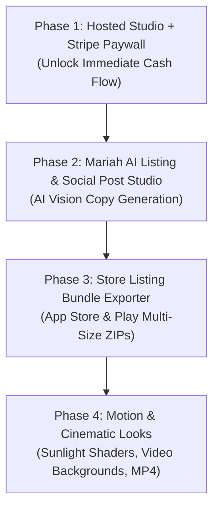

# ShotGenio Competitive Teardown & AppCaptures v2 Product Plan

**Document:** `docs/COMPETITIVE_SHOTGENIO.md`  
**Card:** `A-007` (Tier: T2, docs & product planning only)  
**Date:** 2026-10-25  
**Author:** AppCaptures Director (Antigravity session)  
**Reference Target:** [ShotGenio](https://www.shotgenio.com/) (`https://www.shotgenio.com/` and `https://www.shotgenio.com/pricing`)  
**Evidence Assets:** [`evidence/A-007/`](file:///Users/ploonu/code/appcaptures/evidence/A-007/) (`shotgenio-landing.png`, `shotgenio-pricing.png`, `shotgenio-motion.png`)

---

## 1. Executive Summary & Core Strategic Insight

Dom's directive for AppCaptures v2:
> *"We are going to do this and be better, profit more and use AI."*

ShotGenio positions itself as a *"Screenshot Mockup Maker & AI Post Generator"*. It targets indie hackers and marketers turning single screenshots into social posts (X, LinkedIn, Instagram). It has gained traction through visual eye-candy (animated sunlight shaders, Pexels video motion backgrounds, 3D device tilts, and AI caption writing) paired with an impulse-buy $4.99 one-time payment.

However, **ShotGenio has a fundamental product blindspot**: it is a **single-image social toy**, not a **developer release tool**. 
- It cannot generate compliant multi-screen App Store or Google Play screenshot sets.
- It cannot batch-export the mandatory screenshot dimensions across iPhone 6.9", 6.7", 6.5", iPad 13", and Android.
- It cannot generate App Store listing copy (Title, Subtitle, Promotional Text, Keyword fields, Release Notes).
- It provides zero brand persistence across screens (each image is styled independently).

**The AppCaptures v2 Winning Formula:**
1. **Match ShotGenio's visual polish**: Add hosted browser access, realistic 3D device frames (iPhone 17 Pro, MacBook Pro), sunlight/shadow overlays, and animated MP4/GIF motion backgrounds.
2. **Crush ShotGenio on App Store & Play Store utility (Our Unfair Advantage)**: Keep multi-screen brand consistency, exact store-pixel canvas presets, and one-click ZIP bundle exports for App Store Connect.
3. **Ploonu AI (Mariah Labs / Workers AI) Integration**: Offer dual AI engines:
   - **Store Copywriter**: Reads app screenshots and generates localized App Store titles, subtitles, keyword lists, and feature callouts.
   - **Social Launch Generator**: Generates high-converting X, LinkedIn, and Product Hunt launch posts from the screenshots.
4. **Superior Margins**: Run inference over Cloudflare Workers AI (`@cf/meta/llama-3.2-11b-vision-instruct` / Gemini Flash via AI Gateway) at ~$0.0003/call versus ShotGenio's $0.02–$0.03/credit pricing, producing **90%+ gross margins**.

---

## 2. Feature-by-Feature Teardown: ShotGenio

Analysis verified from live site inspection, client bundle analysis, and network telemetry on 2026-10-25.

### 2.1 Device Mockups, Frames & Looks
- **Mobile Mockups**: iPhone 17, iPhone 17 Pro, iPhone 17 Pro Max (including iridescent/titanium finishes, angled tilts, shadow variations). Android (Samsung Galaxy), generic tablet/iPad, flip phone.
- **Desktop & Laptop Mockups**: MacBook Pro 14″ and 16″ (Sonoma wallpaper, window reflections, isometric desktop views, realistic desk lighting).
- **Window & Browser Frames**: Safari (light/dark bar), Arc browser mockup, Terminal window (retro/hacker), Frosted glass floating window.
- **Styles & Effects**: Glass, neon glow, soft halo, sunset rim, outline pop, chunky brutalism, stacked cards.
- **Wall & Texture Backgrounds**: 84+ curated photo backgrounds (white brick, terrazzo, dark wood, subway tiles, pink plaster).
- **Stickers & Badges**: 580+ animated stickers and tech logos (Stripe, Arc, Dodo, GitHub, currency badges, launch badges).

### 2.2 Animation & Motion Studio
- **Motion Backgrounds (`/motion`)**: 70+ looping video backgrounds backed by a Pexels video proxy (`/api/pexels/videos`).
- **Sunlight Shaders**: Animated overlay simulating moving tree branches, window blinds, and sunset palm shadows swaying across the device mockup.
- **Spotlight Story**: Automatic pan-and-zoom video generator that pans across a screenshot in 9:16 portrait ratio for Instagram Stories / TikTok / YouTube Shorts.
- **Export Formats**: Looping GIF and MP4 video downloads.

### 2.3 AI Post Studio
- **Endpoint**: `POST /api/generate-caption`
- **Payload Schema**:
  ```json
  {
    "imageBase64": "data:image/png;base64,...",
    "mediaType": "image/png",
    "previousCaption": "...",
    "chatInstruction": "make it shorter and punchier"
  }
  ```
- **Capabilities**:
  - Reads image content via Vision LLM.
  - Generates 1–3 paragraph social media posts optimized for X (Twitter), LinkedIn, and Instagram.
  - Multi-turn conversational refinement (adjust tone, format, length).
  - Integrates styled Unicode text (bold, italic, and Zalgo glitch text) directly into the generated caption.
- **Metering**: Deducts 1 AI credit per generation or refinement. Unsuccessful calls refunded. 5 free posts granted on guest arrival.

### 2.4 Export Formats & Canvas Sizes
- **File Formats**: PNG, JPG, WebP, GIF (animated), MP4 (video).
- **Aspect Ratios**: 1:1 (Square, 1080×1080), 16:9 (Landscape, 1600×900), 9:16 (Story, 1080×1920), 4:5 (Portrait, 1080×1350), 4:3.
- **App Store Presets**: Only supports 2 single-canvas sizes: iPhone 6.9″ (1320×2868) and iPad 13″ (2064×2752). Does **not** support batch multi-screen export, 6.7″, 6.5″, 5.5″, or Google Play bundles.

### 2.5 Pricing & Monetization Model
- **Payment Processor / Merchant of Record**: Creem (tax-inclusive USD checkout).
- **Free Tier ($0)**:
  - Basic editor access with no credit card required.
  - 5 initial AI post generation runs.
  - Exports contain a mandatory ShotGenio watermark.
- **Lifetime Editor License**:
  - Displayed as **$4.99 one-time** (marketed as "50% off launch sale" from $9.99).
  - Unlocks full editor forever: watermark removal, 84+ wall backgrounds, 580+ stickers, 70 HD motion backgrounds, and 100 included AI posts.
- **AI Credit Packs (Pay-as-you-go, credits never expire)**:
  - **100 AI Captions**: $2.99 ($0.0299 per caption).
  - **500 AI Captions**: $8.99 ($0.01798 per caption).
- **Subscription**: Zero subscription option. Strictly one-time payment + consumable credit packs.

### 2.6 Onboarding & Platform Experience
- **Zero-Friction Guest Access**: Users can drop an image and immediately style it on the landing page without signing up.
- **Auth Gate**: Authentication modal (`/api/me`) is only triggered when the user exceeds 5 free AI runs or clicks to purchase.
- **Platform**: Web-only Next.js client-side application. No native desktop or mobile app.

### 2.7 Verification Boundary (What Could Not Be Inspected)
- **Private Database Schema**: Exact user/payment tables in Creem / backend.
- **Internal System Prompts**: Exact prompt instructions passed inside `/api/generate-caption` to the vision model.
- **Video Rendering Infrastructure**: Whether MP4 generation is processed purely client-side via WebCodecs/ffmpeg.wasm or offloaded to a serverless rendering worker.

---

## 3. Gap Analysis: ShotGenio vs. AppCaptures Today

| Capability | ShotGenio (Live Competitor) | AppCaptures (v1 Baseline) | Verdict / Opportunity |
| :--- | :--- | :--- | :--- |
| **Primary Target Audience** | Social media creators, indie hackers posting screenshots to X/LinkedIn. | App developers, indie publishers releasing apps to App Store & Google Play. | **Complementary**: AppCaptures can serve both by expanding to social posts while dominating app store listings. |
| **Studio Deployment** | Publicly accessible web studio at `shotgenio.com`. | Local-only dogfood (`localhost:8347/app/`); public site is waitlist only. | **ShotGenio wins today**. AppCaptures must host the studio online behind auth/paywall. |
| **App Store Multi-Screen Sets** | ❌ None. Only exports single ad-hoc canvases. | 🟢 **Core strength**: Multi-screen sequence (1–10 screens) with unified brand layout. | **AppCaptures wins decisively**. |
| **Exact Pixel Compliance** | ⚠️ Only 2 isolated sizes (1320×2868 and 2064×2752). | 🟢 **Full compliance**: iPhone 6.9″, 6.7″, 6.5″, 6.1″, iPad 13″, iPad 12.9″, Android. | **AppCaptures wins decisively**. |
| **Batch ZIP Bundle Export** | ❌ None. Download single images one by one. | 🟢 **Single-click ZIP export** of complete store-ready screenshot packages. | **AppCaptures wins decisively**. |
| **Brand Persistence** | ❌ None. Each graphic is configured from scratch. | 🟢 **Saved Brand Presets**: Colors, font weights, device bezels persist per app (Vidiloop, etc.). | **AppCaptures wins decisively**. |
| **AI Generation** | 🟢 Vision-based social caption writer with multi-turn refinement chat. | ⚠️ Planned stub in `worker.js` (`/api/listing/generate`); unapplied schema. | **ShotGenio wins today**. AppCaptures must ship vision-based AI listing and post copy. |
| **Motion & Animation** | 🟢 70+ looping video backgrounds, swaying sunlight shaders, 9:16 story zoom video. | ❌ Static canvas only today. | **ShotGenio wins today**. AppCaptures can implement client-side canvas shaders & motion. |
| **Device Mockup Variety** | 🟢 iPhone 17 series, MacBook Pro, Arc, Terminal, Samsung, Flip phone. | ⚠️ Realistic iPhone bezels and minimalist frames only. | **ShotGenio leads on variety**. AppCaptures should add MacBook and desktop frames. |
| **Monetization Engine** | 🟢 Live checkout via Creem ($4.99 lifetime + $2.99/$8.99 credit top-ups). | ❌ Waitlist capture only. Stripe integration designed in `docs/SAAS_SPEC.md` but unbuilt. | **ShotGenio wins today**. AppCaptures must land web Stripe checkout. |
| **Runtime & Performance** | Next.js SPA bundle (~1.2MB JS chunks), Pexels video proxy egress. | Vanilla ES modules, zero external framework, sub-10KB JS, edge Cloudflare Worker. | **AppCaptures wins on performance, speed, and architecture**. |

### Where We Match:
- High-resolution client-side canvas rendering.
- Modern device frames (iPhone models, shadows, rounded corners, clean padding).
- Zero-friction guest capability.

### Where We Lose Today:
- Studio is trapped on localhost (`tools/local.sh`), so users cannot access it.
- Lack of motion backgrounds and animated sunlight/shadow effects.
- No live AI generation in production.
- No live payment processing.

### Where We Win (Our Unfair Advantage):
- **Store-Ready Listing Sets**: Real app developers hate Canva and ShotGenio because they must manually resize 10 individual screens across 5 different device sizes. AppCaptures generates the entire store set in 1 click.
- **Ploonu AI Backbone**: Direct integration with Mariah Labs engine (`Kam` / Workers AI / Gemini), allowing cost-effective AI copy generation for both store listings and social launch posts.
- **Clean Edge Stack**: Cloudflare Workers + D1 + R2 + KV provides near-zero server infrastructure overhead.

---

## 4. The "Better" Plan: AppCaptures v2 Scope

Ordered by **Revenue Impact** and **Time to Market**:



### 4.1 Priority 1: Hosted Studio Activation & Web-Only Stripe Checkout
- **Revenue Impact**: **Maximum (Day 1 revenue)**.
- **Implementation**:
  - Move studio from local-only into `/public/app/` as an authenticated/guest shell.
  - Implement **Watermarked Free Mode**: Guest users can design screens, test layouts, and export watermarked PNGs.
  - Integrate **Stripe Checkout** (web-only, avoiding Apple's 30% cut):
    - One-time **Lifetime Studio Pass**: $19 (undercuts annual subscriptions while delivering 4x ShotGenio's value).
    - Optional **Pro Subscription**: $9/month or $79/year for active agencies/indie makers.
    - **Credit Top-Ups**: For heavy AI listing generation.
  - Files Affected: `worker.js` (`/api/checkout`, `/api/webhook`), `schema-saas.sql` (apply tables), `public/app/js/store.js`.

### 4.2 Priority 2: Dual AI Copywriting Engine (Mariah Labs / Workers AI)
- **Revenue Impact**: **High (Powers AI credit purchases and marketing virality)**.
- **Two Specialized AI Modes**:
  1. **App Store Listing Optimizer**:
     - Input: Uploaded screenshot set + app category.
     - Output:
       - Screenshot Headline Callouts (punchy 3–5 word headlines placed above mockups).
       - App Store Title (30 chars) & Subtitle (30 chars).
       - Optimized Keyword Field (100 characters comma-separated).
       - Promotional Text (170 characters) & Description feature bullets.
  2. **Social Media Launch Post Studio**:
     - Input: Single screenshot + target platform (X, LinkedIn, Product Hunt).
     - Output: Compelling launch copy, problem/solution narrative, hashtags, and formatting (bold Unicode text).
- **Architecture & Routing**:
  - Route through **Workers AI** using `@cf/meta/llama-3.2-11b-vision-instruct` (primary, edge-native, ~$0.0003/call) with fallback to **Google Gemini 1.5 Flash** via Cloudflare AI Gateway (~$0.0004/call).
  - Multi-turn refinement chat supported via conversational history.

### 4.3 Priority 3: Complete App Store & Play Store Listing Bundle Generator
- **Revenue Impact**: **High (The core differentiator competitors cannot match)**.
- **Features**:
  - **Single-Click Multi-Device Batching**: User creates 5–8 screens once; AppCaptures automatically renders and packages:
    - iOS 6.9″ Display (1320×2868)
    - iOS 6.7″ Display (1290×2796)
    - iOS 6.5″ Display (1242×2778)
    - iPad Pro 13″ Display (2064×2752)
    - Google Play Phone (1080×1920 or 1080×2400)
    - Landscape Marketing Header (16:9 5244×2950)
  - **ZIP Packaging**: Uses client-side JSZip to deliver a clean directory structured exactly as required by App Store Connect and Play Console.

### 4.4 Priority 4: Mockup Library Expansion, Sunlight Shaders & Motion
- **Revenue Impact**: **Medium (Marketing conversion & feature parity)**.
- **Features**:
  - **Expanded Mockup Frames**: MacBook Pro 14″/16″ with Sonoma/Sequoia wallpapers, minimal flat frame, Android notch/pill.
  - **Animated Sunlight Shaders**: Canvas overlay blending SVG/noise patterns to simulate swaying foliage and window blinds.
  - **Motion Backgrounds & Video Export**: Curated looping motion MP4/WebM backgrounds with client-side WebCodecs / MediaRecorder export to GIF and MP4.

---

## 5. Pricing Proposal & Margin Analysis

> [!IMPORTANT]
> **Status: PROPOSED**. Dominque Cox (Owner, Ploonu LLC) sets final pricing. All prices below reflect recommended commercial positioning.

### 5.1 Pricing Structure

| Tier | Price | Model | Features Included |
| :--- | :--- | :--- | :--- |
| **Free (Starter)** | **$0** | Guest / Free | Unlimited canvas editing, all standard sizes, 5 free AI runs, watermarked export. |
| **Lifetime Studio Pass** | **$19** once | One-Time Payment | Own the studio forever, watermark-free high-res PNG & ZIP exports, all store presets, brand saving, 50 AI credits included. |
| **Pro Creator** | **$9 / mo** or **$79 / yr** | Subscription | Everything in Lifetime + 250 AI credits/mo, team shared presets, priority R2 cloud sync, new templates first. |
| **AI Credit Pack 100** | **$4.99** | Pay-as-you-go | 100 AI Listing or Social Post generations (~$0.049/credit). Never expire. |
| **AI Credit Pack 500** | **$14.99** | Pay-as-you-go | 500 AI Listing or Social Post generations (~$0.029/credit). Never expire. |

### 5.2 Unit Economics & Gross Margin Math

#### Cost Drivers (Per Transaction / Generation):
1. **Stripe Payment Processing**: 2.9% + $0.30 per successful web charge.
2. **Workers AI Vision Inference (`llama-3.2-11b-vision-instruct`)**:
   - Cloudflare Workers AI pricing: Neurons-based (~$0.00032 per vision request).
   - Gemini 1.5 Flash via AI Gateway: ~$0.0004 per image prompt.
3. **Cloudflare Storage & Compute**:
   - Worker execution: Negligible ($0.15 / million requests).
   - R2 Storage: $0.015 / GB-month (zero egress fees).

#### Margin Breakdown:

- **Scenario A: $19 Lifetime Studio Pass**
  - Gross Revenue: **$19.00**
  - Stripe Fee: $0.30 + (2.9% × $19.00) = $0.85
  - 50 Included AI Runs: 50 × $0.0004 = $0.02
  - **Net Profit**: **$18.13**
  - **Gross Margin**: **95.4%**

- **Scenario B: $4.99 AI Credit Pack (100 Credits)**
  - Gross Revenue: **$4.99**
  - Stripe Fee: $0.30 + (2.9% × $4.99) = $0.44
  - 100 AI Inference Runs: 100 × $0.0004 = $0.04
  - **Net Profit**: **$4.51**
  - **Gross Margin**: **90.4%**

- **Scenario C: $9.00/Month Pro Subscription**
  - Gross Revenue: **$9.00**
  - Stripe Fee: $0.30 + (2.9% × $9.00) = $0.56
  - 250 AI Inference Runs: 250 × $0.0004 = $0.10
  - R2 Asset Storage (~500MB): $0.01
  - **Net Profit**: **$8.33**
  - **Gross Margin**: **92.5%**

*Conclusion: Web-only Stripe checkout + Cloudflare Workers AI vision architecture yields extraordinary 90%+ gross margins with zero server GPU maintenance overhead.*

---

## 6. Architecture & File Mapping: v1 Baseline to v2 SaaS

| Feature / Capability | Repository Files Involved | Database & Infra Components |
| :--- | :--- | :--- |
| **Hosted Studio Access** | `app/index.html`, `app/js/*` → move to `public/app/` | Isolated from unauthenticated direct file browsing; manifest updated. |
| **User Accounts & Session** | `worker.js`, `public/app/js/auth.js` | D1 `users`, `sessions` tables; KV session tokens; Turnstile on login. |
| **Stripe Checkout & Webhooks** | `worker.js` (`/api/checkout`, `/api/webhook`) | D1 `purchases`, `credit_balances`; Stripe secret in `wrangler secret put`. |
| **Mariah AI Vision Engine** | `worker.js` (`/api/ai/listing`, `/api/ai/post`) | Workers AI binding `env.AI` or Gemini API key via Cloudflare AI Gateway. |
| **Multi-Screen Listing Bundles** | `public/app/js/render.js`, `public/app/js/ui.js` | Client-side JSZip packaging; local browser canvas rendering. |
| **Mockups & Frames** | `public/app/js/presets.js`, `public/app/frames/*` | SVG / PNG device bezel overlays (iPhone 17 Pro, MacBook Pro). |
| **Motion & Shaders Engine** | `public/app/js/motion.js`, `public/app/js/render.js` | Canvas 2D procedural shaders + WebCodecs / MediaRecorder recording. |
| **Legal & Privacy Gate** | `public/privacy/`, `public/terms/`, `public/support/` | Verified compliance showing `support@appcaptures.com` (already live). |

---

## 7. Ordered Build Cards: Roadmap Proposal (A-008 to A-013)

These proposals are prepared for CoS to copy to `tracks/appcaptures/BOARD.md` upon PR approval:

### `A-008` · SaaS D1 Schema Migration & Magic-Link Auth Shell
- **Tier**: T3a (D1 migration + auth)
- **Scope**: Apply `schema-saas.sql` (`users`, `sessions`, `credits`, `purchases`, `projects`) to D1 `appcaptures_db`. Implement passwordless magic-link authentication via Resend (`support@appcaptures.com`). Maintain Turnstile protection on auth endpoints.
- **Done When**: D1 migration verified; local test suite verifies session token creation and verification; all existing 7 gate suites remain green.

### `A-009` · Web-Only Stripe Checkout & Webhook Handling
- **Tier**: T3b (Billing / secrets)
- **Scope**: Implement `POST /api/stripe/checkout` (Lifetime $19, Pro $9/mo, Credit Packs $4.99/$14.99) and `POST /api/stripe/webhook` with HMAC signature verification. Credit balance auto-increments in D1 upon payment.
- **Done When**: Stripe test mode checkout flow validated; webhook successfully credits account in local workerd; zero secrets committed.

### `A-010` · Hosted Studio Deployment & Watermarked Free Tier
- **Tier**: T2
- **Scope**: Move `/app/` into `public/app/` under the asset manifest. Implement client-side watermark rendering for unpaid accounts and clean exports for verified sessions.
- **Done When**: Asset manifest test updated and passing; unauthenticated users can test studio with watermark; paid accounts export clean assets.

### `A-011` · Mariah Labs / Workers AI Store Listing & Social Post Studio
- **Tier**: T2
- **Scope**: Wire `POST /api/ai/listing` and `POST /api/ai/post` using `@cf/meta/llama-3.2-11b-vision-instruct` (or Gemini 1.5 Flash fallback). Accept screenshot base64, generate store metadata (titles, keywords, callouts) and social posts. Enforce credit balance checks in D1.
- **Done When**: End-to-end tests verify caption generation, credit deduction, and 402 error on zero credits.

### `A-012` · Multi-Device App Store Listing Bundle Exporter
- **Tier**: T2
- **Scope**: Enhance `render.js` to batch-export full App Store Connect sets (iPhone 6.9″, 6.7″, 6.5″, iPad 13″) into a structured ZIP archive in a single operation.
- **Done When**: ZIP output verified across all device folders with exact pixel dimensions matching Apple guidelines.

### `A-013` · MacBook Frames, Sunlight Shaders & Motion Video Export
- **Tier**: T2
- **Scope**: Add MacBook Pro 14″/16″ mockups, animated sunlight/leaf shadow shaders, and looping motion background export via client-side Canvas MediaRecorder (MP4 & GIF).
- **Done When**: 10-second video export runs entirely client-side without server compute cost; tested across desktop and mobile browsers.

---

## 8. Empirical Evidence & File Manifest

- **Evidence Directory**: [`evidence/A-007/`](file:///Users/ploonu/code/appcaptures/evidence/A-007/)
  - `shotgenio-landing.png`: Screenshot of live ShotGenio landing page, editor tease, and look gallery.
  - `shotgenio-pricing.png`: Screenshot of live ShotGenio pricing ($0 Free, $4.99 Lifetime, $2.99/$8.99 AI Credits).
  - `shotgenio-motion.png`: Screenshot of ShotGenio motion studio with looping video backgrounds and MP4 export.
